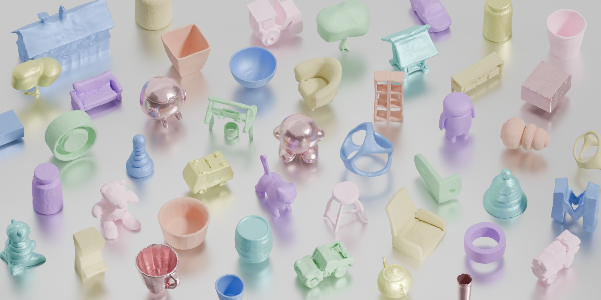
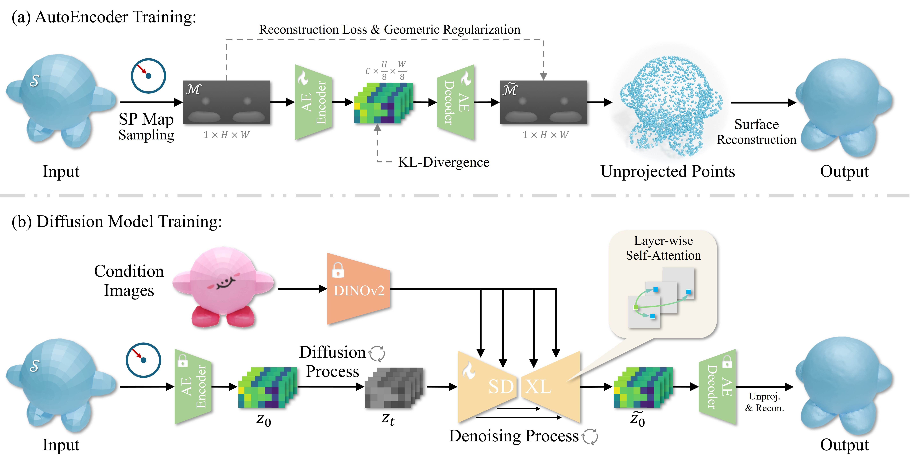

# SPGen: **Spherical Projection as Consistent and Flexible Representation** for Single Image 3D Shape Generation 🌍➡️🧊 [ *SIGGRAPH Asia 2025* ]

<div align="center">

[](https://evergreen0929.github.io/projects/spgen.html)
[](https://arxiv.org/abs/2509.12721)
[](https://youtu.be/ia66Md8T6Bs)

</div>

## :scroll: Introduction

This repository is the official implementation of **SPGen**, a novel framework for high-quality single-image 3D generation.

> **SPGen: Spherical Projection as Consistent and Flexible Representation for Single Image 3D Shape Generation** <br>
> [Jingdong Zhang](https://evergreen0929.github.io/)¹, [Weikai Chen](https://chenweikai.github.io/)²*, [Yuan Liu](https://liuyuan-pal.github.io/)³, [Jionghao Wang](https://shanemankiw.github.io/)¹, [Zhengming Yu](https://yzmblog.github.io/)¹, [Zhuowen Shen](https://mickshen7558.github.io/)¹, [Bo Yang](https://sites.google.com/site/boyanghome/home)⁴, [Wenping Wang](https://scholar.google.com/citations?user=28shvv0AAAAJ&hl=en)¹, [Xin Li](https://people.tamu.edu/~xinli/)¹ <br>
> *¹Texas A&M University, ²LightSpeed Studios, ³HKUST, ⁴Waymo* <br>
> **SIGGRAPH Asia 2025 (Conference Papers)**

Existing single-view 3D generative models often suffer from inter-view inconsistencies or struggle with complex topologies (e.g., internal structures, open surfaces). **SPGen** addresses these limitations by projecting 3D surfaces onto a bounding sphere and unwrapping them into **Multi-layer Spherical Projection (SP) maps**.

**Key Features:**
* **Consistency:** The injective SP mapping naturally eliminates multi-view ambiguity.
* **Flexibility:** Multi-layer design supports nested internal structures and open surfaces.
* **Efficiency:** Operates in the image domain, inheriting powerful 2D priors (SDXL) for fast finetuning.

<p align="center">
  
</p>

## 📝 News
- **[2025-08]** SPGen is accepted to **SIGGRAPH Asia 2025**! 🎉
- **[2025-09]** Paper is available on [arXiv](https://arxiv.org/abs/2509.12721).
- **[2026-10]** Data preparation, training and inference code are released, together with the pretrained [AutoEncoder and normal estimator](https://huggingface.co/jdzhang0929/SPGen-VAE).

## 🏗️ Method Overview

Our pipeline consists of two stages:
1.  **AutoEncoder Training:** Compressing high-resolution multi-layer SP maps into compact latents with geometry regularization.
2.  **Diffusion Model Training:** Finetuning a latent diffusion model (based on SDXL) with Layer-wise Self-Attention to generate consistent 3D geometry from a single image.

<p align="center">
  
</p>

## 🛠️ Installation

```bash
conda create -n spgen python=3.10 -y
conda activate spgen
pip install torch==2.4.1 torchvision==0.19.1 --index-url https://download.pytorch.org/whl/cu121
pip install -r requirements.txt

# required by the normal estimator (modules from Shape As Points), the wheel must match your PyTorch / CUDA version
pip install torch_scatter -f https://data.pyg.org/whl/torch-2.4.0+cu121.html

# optional: memory efficient attention for the diffusion UNet
pip install xformers==0.0.28.post1 --index-url https://download.pytorch.org/whl/cu121
# optional: farthest point sampling at inference (random sampling is used otherwise)
pip install "git+https://github.com/facebookresearch/pytorch3d.git@stable" --no-build-isolation
```

For other PyTorch / CUDA versions, pick the matching `torch_scatter` wheel from [pytorch_scatter](https://github.com/rusty1s/pytorch_scatter) (e.g. `torch-<version>+cu<version>.html`).

## 📂 Code Structure

| Entry point | Launcher | Description |
| --- | --- | --- |
| `representations/` | see its [README](representations/README.md) | Data preparation: download (`download_data.py`), SP maps, rendering, quality filtering, point clouds for the normal estimator. |
| `train_vae.py` | `scripts/train_vae.sh` | Stage 1: finetune the AutoEncoder on SP depth maps. |
| `encode_latents.py` | `scripts/encode_latents.sh` | Stage 2: encode SP maps (and condition images) into latents. |
| `train_diffusion.py` | `scripts/train_diffusion.sh` | Stage 3: finetune the SDXL UNet on SP map latents. |
| `train_normal_estimator.py` | `scripts/train_normal_estimator.sh` | Train the point-cloud normal estimator. |
| `inference.py` | `scripts/inference.sh` | Single image to SP maps, point cloud and mesh. |

| Module | Content |
| --- | --- |
| `spgen/models/sp_unet.py` | `SPUNet`: wraps the SDXL UNet and replaces its self-attention processors with Layer-wise Self-Attention. |
| `spgen/models/normal_estimator/` | `NormalEstimator` (Shape As Points encoder / decoder + 3D UNet). |
| `spgen/pipelines/pipeline_spgen.py` | `SPGenPipeline`: DINOv2 conditioning, classifier-free guidance and Euler Ancestral sampling of the SP map latents, decoding with the AutoEncoder. |
| `spgen/data/datasets.py` | `SPMapDataset` (stage 1), `SPLatentDataset` (stage 3), `PointCloudDataset` (normal estimator). |
| `spgen/losses.py` | Geometry regularization: `EdgeLoss` (L_edge) and `frequency_domain_loss` (L_spec). |
| `spgen/utils.py` | Circular padding, SP map I/O, lifting SP depth maps to 3D points, checkpoint helpers. |

## 📦 Data Preparation

Follow [representations/README.md](representations/README.md) to download Objaverse, compute 4-layer SP maps (`256 x 512`), render the condition images and sample oriented point clouds. The SP map latents (step 5) are computed after the AutoEncoder has been finetuned (stage 1 below).

All models are trained only on the `train` split, i.e. the 159,912 Objaverse objects listed in [`representations/uids/train.txt`](representations/uids/train.txt). The 1,993 objects in [`representations/uids/test.txt`](representations/uids/test.txt) are held out for evaluation and are not read by any training script.

## 🚀 Training

All stages use [accelerate](https://github.com/huggingface/accelerate). The provided launchers reproduce the paper setting (same total batch sizes) on 8 GPUs with 48 GB each; set `NUM_GPUS`, `DATA_ROOT`, `OUTPUT_DIR`, ... as environment variables, extra arguments are forwarded to the Python scripts.

**Stage 1: AutoEncoder.** The SDXL AutoEncoder is converted to single-channel input / output and finetuned on SP maps with the geometry regularization `L = L_recon + 0.1 L_edge + 5e-4 L_spec` (40k iterations, batch size 64, lr 1e-4 with cosine annealing).

```bash
DATA_ROOT=/path/to/data bash scripts/train_vae.sh
```

**Stage 2: SP map latents.** Encode the SP maps with the finetuned AutoEncoder.

```bash
DATA_ROOT=/path/to/data VAE_PATH=exp/vae/pretrained-40000/vae bash scripts/encode_latents.sh
```

**Stage 3: Diffusion UNet.** The SDXL UNet is finetuned to denoise the latents of all SP layers of an object jointly. Its self-attention layers are replaced by Layer-wise Self-Attention, i.e. the tokens of all SP layers are concatenated before attention, and the input image conditions the model through cross-attention on its DINOv2 tokens (80k iterations, batch size 80, lr 1e-5 with 1000 warmup steps, v-prediction, DDIM training scheduler).

```bash
DATA_ROOT=/path/to/data VAE_PATH=exp/vae/pretrained-40000/vae bash scripts/train_diffusion.sh
```

Every checkpoint folder `exp/diffusion/checkpoint-<step>/` contains the UNet (`unet/`), the scheduler config and `spgen_config.json`, which are loaded by the inference script.

**Normal estimator.** The point encoder, local decoder and 3D UNet are adapted from [Shape As Points](https://github.com/autonomousvision/shape_as_points) (`spgen/models/normal_estimator/`, MIT license). Points are scattered into a `32^3` feature grid (`torch_scatter`), processed by a 5-level 3D UNet and decoded to a unit normal per point. The network is trained from scratch with an L1 loss on oriented point clouds sampled from the GT meshes (25,600 points per shape, 40k iterations, batch size 192, lr 1e-3 with cosine annealing). It always runs in fp32 since `torch_scatter` does not support half precision. The point clouds are prepared with `open3d` (unsigned distance), `PyMCubes` (marching cubes) and `trimesh` (surface sampling), see step 7 of [representations/README.md](representations/README.md).

```bash
python representations/data/prepare_normal_data.py --data_root /path/to/data --splits train
DATA_ROOT=/path/to/data bash scripts/train_normal_estimator.sh
```

## 🎨 Inference

**Pretrained weights.**

| Component | Weights | Argument of `inference.py` |
| --- | --- | --- |
| AutoEncoder | [jdzhang0929/SPGen-VAE](https://huggingface.co/jdzhang0929/SPGen-VAE) `vae/` | `--vae_path` |
| Normal estimator | [jdzhang0929/SPGen-VAE](https://huggingface.co/jdzhang0929/SPGen-VAE) `normal_estimator/` | `--normal_estimator_path` |
| Diffusion UNet | your stage 3 checkpoint `exp/diffusion/checkpoint-<step>` | `--unet_path` |
| Image encoder | [facebook/dinov2-large](https://huggingface.co/facebook/dinov2-large) (downloaded automatically) | `--image_encoder` |

```bash
huggingface-cli download jdzhang0929/SPGen-VAE --local-dir weights/SPGen-VAE

python inference.py --input path/to/image_or_folder --output_dir outputs \
    --unet_path exp/diffusion/checkpoint-80000 \
    --vae_path weights/SPGen-VAE/vae \
    --normal_estimator_path weights/SPGen-VAE/normal_estimator \
    --steps 40 --guidance_scale 4.5 --seed 0 --save_maps --save_pcd
# or: INPUT=path/to/images UNET_PATH=... VAE_PATH=... NORMAL_ESTIMATOR_PATH=... bash scripts/inference.sh
```

`--input` accepts a single image or a folder of images (`.png`, `.jpg`, `.webp`); images with an alpha channel are composited on a white background and resized to `512 x 512`. The number of SP layers is read from `spgen_config.json` of the UNet checkpoint. For every input `<name>` the script writes:

| Output | Description |
| --- | --- |
| `outputs/<name>.ply` | Reconstructed mesh. |
| `outputs/<name>/maps/depth_{0..3}.png` | Generated 16-bit SP maps (`--save_maps`). |
| `outputs/<name>_pcd.ply` | Oriented point cloud used for Poisson reconstruction (`--save_pcd`). |

The SP maps are sampled with the Euler Ancestral scheduler, lifted to 3D points (pixels at depth discontinuities are removed with `--edge_threshold`), down-sampled to `--num_points` points, oriented by the normal estimator and converted into a mesh with Poisson reconstruction (`--poisson_depth`).

The components can also be used from Python:

```python
import torch
from diffusers import AutoencoderKL, UNet2DConditionModel
from transformers import AutoImageProcessor, AutoModel
from spgen.models import SPUNet
from spgen.models.normal_estimator import NormalEstimator
from spgen.pipelines import SPGenPipeline
from spgen.pipelines.pipeline_spgen import load_schedulers
from spgen.utils import open_image_with_background, set_circular_padding

ckpt = "exp/diffusion/checkpoint-80000"
_, scheduler = load_schedulers(ckpt)  # Euler Ancestral sampler matching the training noise schedule
unet = UNet2DConditionModel.from_pretrained(ckpt, subfolder="unet", torch_dtype=torch.float16)
unet = SPUNet(unet).to("cuda").eval()
vae = AutoencoderKL.from_pretrained("weights/SPGen-VAE", subfolder="vae").to("cuda")
set_circular_padding(unet)
set_circular_padding(vae)

pipeline = SPGenPipeline(vae=vae, unet=unet, scheduler=scheduler,
                         image_encoder=AutoModel.from_pretrained("facebook/dinov2-large").to("cuda", torch.float16),
                         image_processor=AutoImageProcessor.from_pretrained("facebook/dinov2-large"))
image = open_image_with_background("example.png").resize((512, 512))
with torch.autocast("cuda"):
    sp_maps, latents = pipeline(image, num_layers=4, num_inference_steps=40, guidance_scale=4.5)  # (4, 1, 256, 512) in [-1, 1]

normal_estimator = NormalEstimator.from_pretrained("weights/SPGen-VAE/normal_estimator").to("cuda")  # (B, N, 3) points -> unit normals
```

## 📅 Todo
- [x] Dataset preparation scripts (Objaverse uid lists, SP maps, rendering, latents, point clouds).
- [x] Training code: AutoEncoder, diffusion UNet with Layer-wise Self-Attention, normal estimator.
- [x] Inference code (single image to mesh).
- [x] Pretrained AutoEncoder and normal estimator.

## 🙏 Acknowledgements

This work builds upon [Stable Diffusion XL](https://github.com/Stability-AI/generative-models), [diffusers](https://github.com/huggingface/diffusers) and [DINOv2](https://github.com/facebookresearch/dinov2). The normal estimator is adapted from [Shape As Points](https://github.com/autonomousvision/shape_as_points) and [pytorch-3dunet](https://github.com/wolny/pytorch-3dunet) (see `spgen/models/normal_estimator/LICENSE`), and the rendering scripts are adapted from [Wonder3D](https://github.com/xxlong0/Wonder3D) (see `representations/render_codes/LICENSE.txt`). We thank the authors for releasing their code.

## 📥 Citation
If you find our work and this repository useful, please consider starring the repo and citing our paper:

```bibtex
@inproceedings{zhang2025spgen,
  title={SPGen: Spherical Projection as Consistent and Flexible Representation for Single Image 3D Shape Generation},
  author={Zhang, Jingdong and Chen, Weikai and Liu, Yuan and Wang, Jionghao and Yu, Zhengming and Shen, Zhuowen and Yang, Bo and Wang, Wenping and Li, Xin},
  booktitle={SIGGRAPH Asia 2025 Conference Papers},
  year={2025},
  publisher={ACM},
  doi={10.1145/3757377.3763959}
}
